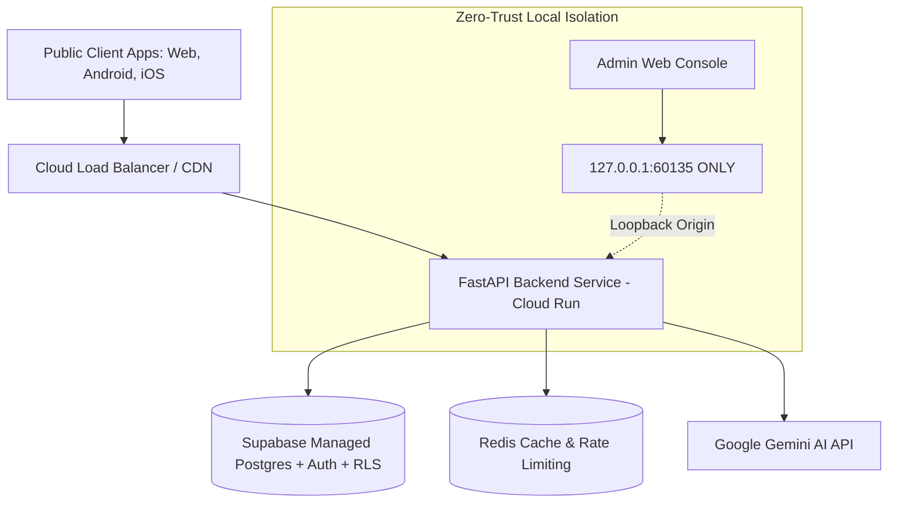

# Truthprenuer Infrastructure & Cloud Topology (`INFRASTRUCTURE/DOCUMENTATION/`)

## 1. Cloud Architecture Overview

## 2. Security Boundaries
- **Public Domain:** User apps communicate over TLS 1.3 to the backend API.
- **Admin Domain:** Strict localhost loopback binding (`127.0.0.1:60135`). Zero external reachability.
- **Database Domain:** Supabase PostgreSQL with 100% Row Level Security (RLS) enforcement.
