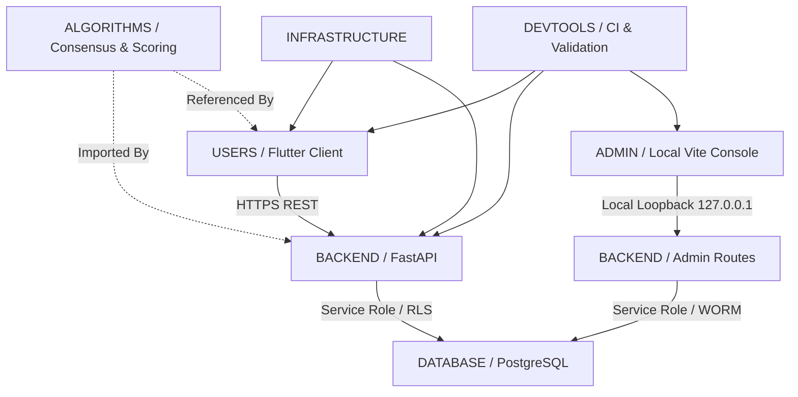

# Truthprenuer Repository Architecture & Module Boundaries (`REPOSITORY_ARCHITECTURE.md`)

## 1. System Philosophy
Truthprenuer is organized around **bounded contexts, zero-trust network boundaries, and reproducible builds**.
Every file in the repository possesses:
1. **A Single Purpose:** Cohesive, modular functionality with minimal side-effects.
2. **Documented Ownership:** Explicit architectural subsystem mapping.
3. **Strict Boundaries:** Public client code cannot access administrative logic; local administrative tooling cannot leak to public clouds.

## 2. Module Boundaries & Dependency Flow

### Dependency Rules:
- **`USERS/` -> `BACKEND/`**: Outward HTTPS communication only via documented `/api/v1/*` routes.
- **`ADMIN/` -> `BACKEND/`**: Restricted strictly to loopback origin (`127.0.0.1:60135` / `localhost:60135`).
- **`BACKEND/` -> `DATABASE/`**: PostgreSQL communication via Supabase REST & async clients with RLS enforcement.
- **`USERS/` NEVER imports `ADMIN/`**: Strict dead-code elimination. The admin console is never bundled into mobile/web user releases.

---

## 3. Directory Responsibilities

| Subsystem | Responsibility | Critical Files |
| :--- | :--- | :--- |
| **`USERS/`** | Public mobile, desktop, and web applications for founders and validators | [`lib/`](../../USERS/lib), [`web/`](../../USERS/WEB), [`android/`](../../USERS/ANDROID), [`ios/`](../../USERS/IOS) |
| **`ADMIN/`** | Private administrative console running strictly on local loopback | [`admin_panel/`](../../ADMIN), [`ADMIN/RUN_LOCAL/`](../../ADMIN/RUN_LOCAL) |
| **`DATABASE/`** | Relational schemas, migrations, triggers, indexes, and WORM policies | [`DATABASE/SCHEMA/`](../../DATABASE/SCHEMA), [`DATABASE/POLICIES/`](../../DATABASE/POLICIES) |
| **`BACKEND/`** | Asynchronous FastAPI service exposing public and administrative routes | [`backend/app/`](../../backend/app) |
| **`ALGORITHMS/`** | Bayesian consensus algorithms, dynamic scoring, and anti-sybil weighting | [`ALGORITHMS/VALIDATION/`](../../ALGORITHMS/VALIDATION) |
| **`INFRASTRUCTURE/`** | Cloud topologies, Dockerfiles, Cloudflare routing, and telemetry | [`INFRASTRUCTURE/DEPLOYMENT/`](../../INFRASTRUCTURE/DEPLOYMENT) |
| **`DEVTOOLS/`** | Repository integrity validators, test suites, and security scanners | [`DEVTOOLS/REPOSITORY_MAINTENANCE/`](../../DEVTOOLS/REPOSITORY_MAINTENANCE) |
| **`PRODUCT/`** | PRD, requirements, user journeys, runbooks, and QA reports | [`PRODUCT/`](../../PRODUCT) |
