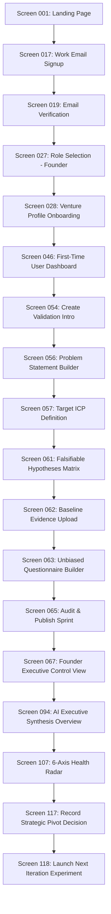
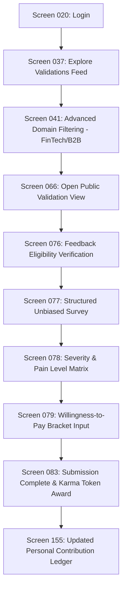
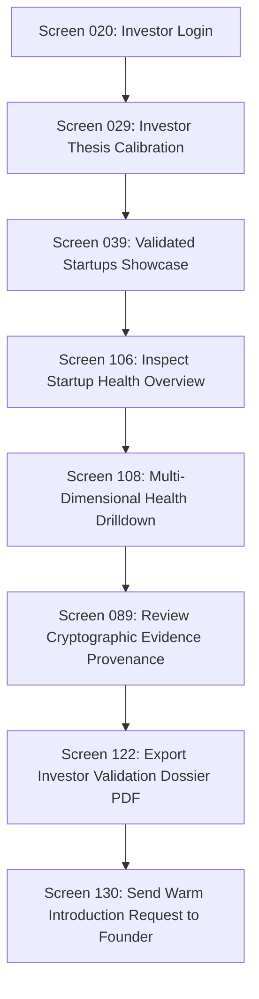
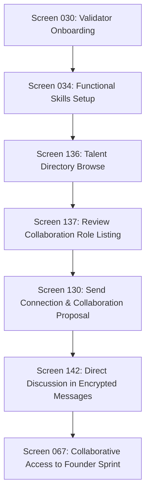
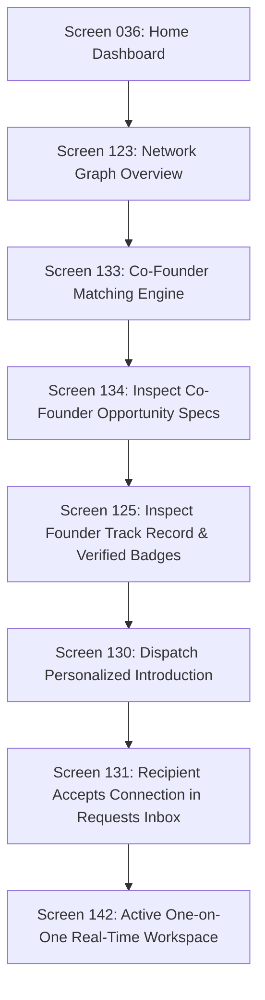
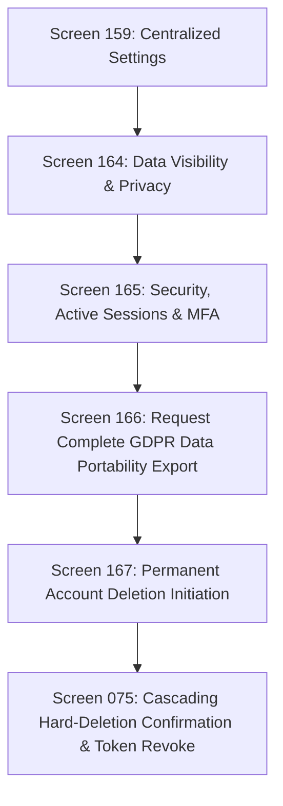
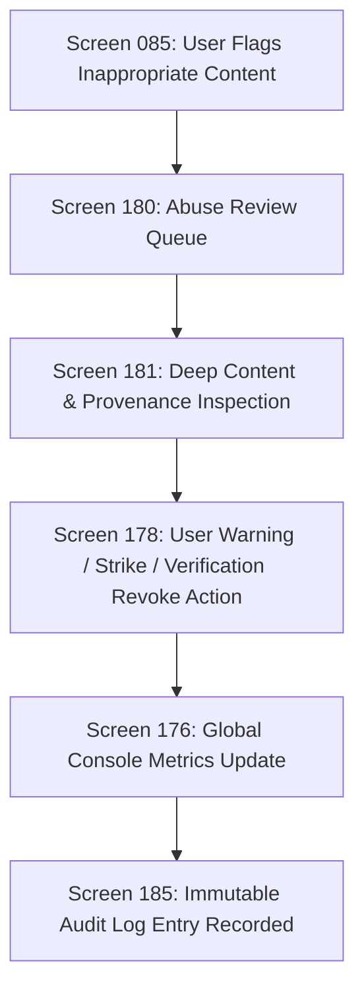

# TRUTHPRENUER — Information Architecture, Sitemap & User Journeys
**Version:** 2.0.0 (Master IA Architecture)  
**Modules Covered:** 20 Modules (Module A through Module T)  
**Total Screen Count:** 195 Unique Artboard Screens

---

## 1. Master Information Architecture & Sitemap Tree

```
TRUTHPRENUER PLATFORM
│
├── [PUBLIC MARKETING & PRE-AUTH] (Module A: Screens 001–015)
│   ├── / (001: Main Landing Page)
│   ├── /how-it-works (002: How Truthprenuer Works)
│   ├── /features (003: Product Features Overview)
│   ├── /human-validation (004: Human Validation Explained)
│   ├── /ai-validation (005: AI Validation Explained)
│   ├── /startup-analysis (006: Startup Analysis & Intelligence)
│   ├── /health-readiness (007: Startup Health & Readiness)
│   ├── /use-cases (008: Use Cases by User Persona)
│   ├── /case-studies (009: Founder Success Stories)
│   ├── /pricing (010: Pricing & Plan Tiers)
│   ├── /pricing-compare (011: Feature Matrix Comparison)
│   ├── /about (012: Mission & Manifesto)
│   ├── /blog (013: Validation Science Blog Listing)
│   ├── /blog/:slug (014: In-Depth Article Detail)
│   └── /contact (015: Contact, Sales & Support)
│
├── [AUTHENTICATION & RECOVERY] (Module B: Screens 016–025)
│   ├── /auth/signup-phone (016: SMS/Phone Sign Up)
│   ├── /auth/signup-email (017: Work/Personal Email Sign Up)
│   ├── /auth/verify-phone (018: 6-Digit Phone OTP Verification)
│   ├── /auth/verify-email (019: Email Magic Link / Token Verification)
│   ├── /auth/login (020: Secure Credential Login)
│   ├── /auth/social (021: Google / GitHub / LinkedIn OAuth Flow)
│   ├── /auth/reset-password (022: Secure Password Create / Reset)
│   ├── /auth/forgot-password (023: Password Recovery Dispatcher)
│   ├── /auth/recovery-challenge (024: Multi-Factor Account Recovery)
│   └── /auth/session-timeout (025: Session Expired Modal & Re-Auth)
│
├── [ONBOARDING & ROLE ADAPTATION] (Module C: Screens 026–035)
│   ├── /onboarding/welcome (026: Platform Mission & Walkthrough)
│   ├── /onboarding/role-select (027: Multi-Persona Role Selector)
│   ├── /onboarding/founder (028: Founder Venture Profile Setup)
│   ├── /onboarding/investor (029: Investor Thesis & Ticket Calibration)
│   ├── /onboarding/validator (030: Validator Domain Expertise Setup)
│   ├── /onboarding/student (031: Aspiring Founder / Student Onboarding)
│   ├── /onboarding/creator (032: Startup Mentor / Creator Setup)
│   ├── /onboarding/industries (033: Target Industry & Sector Multi-Select)
│   ├── /onboarding/skills (034: Functional Expertise & Skills Cloud)
│   └── /onboarding/complete (035: Profile Setup Success & First Action)
│
├── [DISCOVERY & SEARCH ENGINE] (Module D: Screens 036–045)
│   ├── /app/home (036: Main Role-Adaptive Home Dashboard)
│   ├── /app/explore/validations (037: Live Validation Discovery Engine)
│   ├── /app/explore/people (038: Expert Validator & Peer Directory)
│   ├── /app/explore/startups (039: Validated Startup Showcase)
│   ├── /app/search (040: Global Omnisearch Results Page)
│   ├── /app/search/advanced (041: Multi-Facet Parameterized Search)
│   ├── /app/search/saved (042: Saved Search Queries & Alert Feed)
│   ├── /app/trending (043: Trending Validation Sprints & Themes)
│   ├── /app/bookmarks (044: Saved Opportunities & Benchmarks)
│   └── /app/search/empty (045: Search Zero-Results & Suggested Queries)
│
├── [ROLE WORKSPACES & CO-PILOT] (Module E: Screens 046–053)
│   ├── /app/workspace/first-time (046: Day-One Blank Slate Setup Guidance)
│   ├── /app/workspace/founder (047: Founder Command Center)
│   ├── /app/workspace/active-sprint (048: Real-Time Active Sprint Console)
│   ├── /app/workspace/activity-feed (049: Chronological Telemetry Feed)
│   ├── /app/workspace/recommendations (050: AI Next-Best-Action Priorities)
│   ├── /app/workspace/weekly-digest (051: Weekly Evidence & Velocity Digest)
│   ├── /app/workspace/opportunities (052: Personalized Validation Matches)
│   └── /app/workspace/customize (053: Dashboard Widget & Density Preferences)
│
├── [VALIDATION AUTHORING PIPELINE] (Module F: Screens 054–065)
│   ├── /app/validate/new (054: Sprint Creation Initiation)
│   ├── /app/validate/type (055: Sprint Methodology Selector)
│   ├── /app/validate/problem (056: Problem Statement & Pain Indexer)
│   ├── /app/validate/customer (057: Ideal Customer Profile & Segment)
│   ├── /app/validate/solution (058: Proposed MVP & Value Mechanics)
│   ├── /app/validate/value-prop (059: Differentiator & Moat Hypothesis)
│   ├── /app/validate/business-model (060: Monetization & Pricing Assumptions)
│   ├── /app/validate/hypotheses (061: Falsifiable Assumptions Matrix)
│   ├── /app/validate/evidence-upload (062: Baseline Artifacts & Research Files)
│   ├── /app/validate/questionnaire (063: Unbiased Survey Question Builder)
│   ├── /app/validate/audience (064: Privacy, Governance & Validator Scope)
│   └── /app/validate/review (065: Pre-Flight Review, Audit & Publish)
│
├── [VALIDATION LIFECYCLE MANAGEMENT] (Module G: Screens 066–075)
│   ├── /app/validations/:id/public (066: Public Validator View)
│   ├── /app/validations/:id/private (067: Founder Executive Control View)
│   ├── /app/validations/:id/overview (068: Sprint Progress & Sample Telemetry)
│   ├── /app/validations/:id/edit (069: In-Flight Sprint Configuration Editor)
│   ├── /app/validations/:id/settings (070: Privacy, Access Keys & Notifications)
│   ├── /app/validations/:id/pause (071: Pause Sprint Confirmation Modal)
│   ├── /app/validations/:id/extend (072: Extend Target Sample / Close Sprint)
│   ├── /app/validations/:id/branch (073: Duplicate / Fork Experiment Branch)
│   ├── /app/validations/:id/archive (074: Archive Sprint Data Package)
│   └── /app/validations/:id/delete (075: Permanent Hard Deletion Safety Gate)
│
├── [HUMAN FEEDBACK & PEER REVIEW] (Module H: Screens 076–085)
│   ├── /app/feedback/:id/intro (076: Feedback Participant Eligibility & Gate)
│   ├── /app/feedback/:id/questions (077: Structured Unbiased Questionnaire)
│   ├── /app/feedback/:id/ratings (078: Severity, Frequency & Pain Scale)
│   ├── /app/feedback/:id/wtp (079: Willingness-to-Pay Van Westendorp Grid)
│   ├── /app/feedback/:id/frequency (080: Problem Occurrence & Friction Index)
│   ├── /app/feedback/:id/discussion (081: Public Threaded Question & Response)
│   ├── /app/feedback/:id/reply (082: Founder Clarification & Thread Reply)
│   ├── /app/feedback/:id/success (083: Feedback Submitted & Karma Token Receipt)
│   ├── /app/feedback/:id/edit (084: Edit / Withdraw Submitted Response)
│   └── /app/feedback/:id/report (085: Flag Inappropriate / Biased Response)
│
├── [EVIDENCE LOCKER & PROVENANCE] (Module I: Screens 086–093)
│   ├── /app/evidence (086: Evidence Locker Multi-Asset Overview)
│   ├── /app/evidence/:id (087: Evidence Artifact Inspector & Metadata)
│   ├── /app/evidence/upload (088: Multi-File Ingestion Dropzone & Parse)
│   ├── /app/evidence/provenance (089: Verification Chain & Audit Provenance)
│   ├── /app/evidence/taxonomies (090: Evidence Tagging & Semantic Clustering)
│   ├── /app/evidence/review (091: Evidence Quality Score & Falsification Check)
│   ├── /app/evidence/link (092: Hypothesis-Evidence Relational Mapper)
│   └── /app/evidence/export (093: Cryptographic Proof Package Export)
│
├── [AI ANALYSIS & EVIDENCE SYNTHESIS] (Module J: Screens 094–105)
│   ├── /app/ai/overview (094: AI Executive Synthesis Overview)
│   ├── /app/ai/scope (095: Model Calibration & Analysis Scope Setup)
│   ├── /app/ai/processing (096: Deep Reasoning In-Progress Animation)
│   ├── /app/ai/summary (097: Executive Evidence Synthesis Document)
│   ├── /app/ai/assumptions (098: Assumption Falsification & Validation Grid)
│   ├── /app/ai/problem-fit (099: Problem-Solution Fit Confidence Radar)
│   ├── /app/ai/customer-segments (100: Customer Persona Resonance Clustering)
│   ├── /app/ai/pricing-elasticity (101: Price Sensitivity & Elasticity Curves)
│   ├── /app/ai/market-landscape (102: Competitive Alternatives & Market Gaps)
│   ├── /app/ai/signal-matrix (103: Green vs Red Signal Conviction Matrix)
│   ├── /app/ai/contradictions (104: Contradiction Analyzer & Blind Spots)
│   └── /app/ai/next-experiments (105: Prescriptive Next Experiment Blueprints)
│
├── [STARTUP HEALTH & VALIDATION RADAR] (Module K: Screens 106–115)
│   ├── /app/health/overview (106: Macro Startup Health Dashboard)
│   ├── /app/health/radar (107: 6-Axis Hexagonal Health Radar)
│   ├── /app/health/breakdown (108: Multi-Dimensional Health Score Drilldown)
│   ├── /app/health/problem-score (109: Pillar 1: Problem Urgency Score)
│   ├── /app/health/demand-score (110: Pillar 2: Organic Demand Score)
│   ├── /app/health/solution-score (111: Pillar 3: Solution Feasibility Score)
│   ├── /app/health/market-score (112: Pillar 4: Market Dynamics Score)
│   ├── /app/health/traction-score (113: Pillar 5: Velocity & Traction Score)
│   ├── /app/health/revenue-score (114: Pillar 6: Unit Economics & Monetization)
│   └── /app/health/team-score (115: Pillar 7: Execution & Team Balance Score)
│
├── [DECISION LOG & EXPERIMENTS] (Module L: Screens 116–122)
│   ├── /app/decisions (116: Immutable Decision Audit Log)
│   ├── /app/decisions/new (117: Create Falsifiable Decision Record)
│   ├── /app/experiments (118: Lean Experiment Backlog & Kanban)
│   ├── /app/experiments/:id (119: Experiment Protocol & Outcome Tracking)
│   ├── /app/recommendations (120: Strategic Pivot / Persevere Decision Deck)
│   ├── /app/timeline (121: Startup Validation Journey Timeline)
│   └── /app/reports/export (122: Investor-Ready Validation PDF/JSON Dossier)
│
├── [NETWORK & INVESTOR DISCOVERY] (Module M: Screens 123–132)
│   ├── /app/network (123: Network Graph & Suggested Connections)
│   ├── /app/network/founders (124: Founder Ecosystem Directory & Filters)
│   ├── /app/network/founders/:id (125: Public Founder Portfolio & Verified Badges)
│   ├── /app/network/investors (126: Accredited Investor & VC Directory)
│   ├── /app/network/investors/:id (127: Investor Thesis & Ticket Profile)
│   ├── /app/network/validators (128: Verified Domain Expert Leaderboard)
│   ├── /app/network/validators/:id (129: Validator Credential & Accuracy Score)
│   ├── /app/network/connect-modal (130: Personalized Connection Invitation)
│   ├── /app/network/inbox (131: Connection Requests Management Center)
│   └── /app/network/mutuals (132: Second-Degree Warm Introductions Hub)
│
├── [TALENT & CO-FOUNDER MARKETPLACE] (Module N: Screens 133–140)
│   ├── /app/talent/cofounders (133: Co-Founder Matching Engine)
│   ├── /app/talent/cofounders/:id (134: Co-Founder Opportunity Specification)
│   ├── /app/talent/cofounders/new (135: Create Co-Founder Opportunity Listing)
│   ├── /app/talent/directory (136: Builder, Designer & Growth Talent Pool)
│   ├── /app/talent/roles/:id (137: Collaborative Project / Role Details)
│   ├── /app/talent/roles/new (138: Create Fractional / Full-Time Posting)
│   ├── /app/talent/applicants (139: Applicant Tracking Pipeline & Scoring)
│   └── /app/talent/my-listings (140: Active Postings & Collaboration Controls)
│
├── [MESSAGING & COLLABORATION HUBS] (Module O: Screens 141–150)
│   ├── /app/messages (141: Real-Time Conversations Split Inbox)
│   ├── /app/messages/:id (142: High-Density Direct Chat with Evidence Drawer)
│   ├── /app/messages/new (143: Compose New Encrypted Direct Message)
│   ├── /app/messages/requests (144: Message Requests & Spam Quarantine)
│   ├── /app/messages/search (145: Full-Text Message & Artifact Search)
│   ├── /app/notifications (146: Real-Time Activity & Alert Center)
│   ├── /app/notifications/prefs (147: Granular Channel & Alert Preferences)
│   ├── /app/communities (148: Domain & Industry Communities Hub)
│   ├── /app/communities/:slug (149: Community Feed, Debates & Sprints)
│   └── /app/communities/manage (150: Community Moderation & Governance)
│
├── [REPUTATION, PASSPORT & ACHIEVEMENTS] (Module P: Screens 151–158)
│   ├── /app/profile/me (151: Personal Authenticated Master Profile)
│   ├── /app/profile/edit (152: Comprehensive Profile & Identity Editor)
│   ├── /app/profile/preview (153: Public Visitor Perspective Preview)
│   ├── /app/profile/expertise (154: Verified Domain Skills & Proof Portfolio)
│   ├── /app/profile/contributions (155: Validation Sprint Peer Reviews Record)
│   ├── /app/profile/achievements (156: Validation Passport & Badge Showcase)
│   ├── /app/profile/karma-history (157: Karma Points, Proof-of-Review Ledger)
│   └── /app/profile/credentials (158: Third-Party Credential Verification)
│
├── [SETTINGS, PRIVACY & SECURITY] (Module Q: Screens 159–168)
│   ├── /app/settings (159: Centralized Settings Overview Dashboard)
│   ├── /app/settings/account (160: Primary Email, Phone & Identity Details)
│   ├── /app/settings/appearance (161: Theme Mode, Typography & Density)
│   ├── /app/settings/notifications (162: Push, Email & In-App Alert Toggles)
│   ├── /app/settings/connected (163: Linked OAuth & Cloud Storage Integrations)
│   ├── /app/settings/privacy (164: Data Visibility, RLS Scope & Anonymity)
│   ├── /app/settings/security (165: Password, MFA & Active Sessions Manager)
│   ├── /app/settings/export (166: GDPR Data Portability & JSON Dossier Request)
│   ├── /app/settings/delete-account (167: Permanent Account & Sprint Erasure Flow)
│   └── /app/settings/consent (168: Legal Consents & Model Training Opt-Outs)
│
├── [HELP, POLICIES & LEGAL CENTER] (Module R: Screens 169–175)
│   ├── /help (169: Knowledge Base & Validation Playbook)
│   ├── /help/search (170: Help Article Real-Time Search Results)
│   ├── /help/ticket (171: Concierge Support Ticket Form)
│   ├── /help/bug-report (172: Technical Bug & Feedback Dispatcher)
│   ├── /legal/terms (173: Institutional Terms of Service)
│   ├── /legal/privacy (174: Global Privacy Policy & GDPR/CCPA Addendum)
│   └── /legal/guidelines (175: Community Validation Conduct & Peer Ethics)
│
├── [ADMINISTRATION & PLATFORM GOVERNANCE] (Module S: Screens 176–185)
│   ├── /admin (176: Global Platform Governance Command Center)
│   ├── /admin/users (177: User Directory, Roles & Ban Management)
│   ├── /admin/users/:id (178: User Deep Audit & Permission Override)
│   ├── /admin/sprints (179: Live Validation Moderation Queue)
│   ├── /admin/abuse (180: Reported Flagged Content Review Workbench)
│   ├── /admin/content/:id (181: Deep Content Inspection & Strike Action)
│   ├── /admin/communities (182: Platform-Wide Community Administration)
│   ├── /admin/taxonomies (183: Industry, Tags & Methodology Taxonomies)
│   ├── /admin/telemetry (184: Real-Time Infrastructure & WebSocket Health)
│   └── /admin/audit-log (185: Cryptographic Administrative Audit Log)
│
└── [GLOBAL STATES & RESPONSIVE ADAPTATIONS] (Module T: Screens 186–195)
    ├── [STATE] (186: Global Content Skeleton & Loading Pipeline)
    ├── [STATE] (187: Universal Zero-Data Empty Workspace Canvas)
    ├── [STATE] (188: Empty Search & Discovery Canvas)
    ├── [STATE] (189: Empty Validation Sprints Portfolio)
    ├── [STATE] (190: Omnisearch No-Results With Recovery Suggestions)
    ├── [STATE] (191: 403 Forbidden / Role-Restricted Access Barrier)
    ├── [STATE] (192: 401 Session Expired Overlay with In-Line Re-Auth)
    ├── [STATE] (193: 500 Infrastructure Error with Graceful Recovery)
    ├── [STATE] (194: Offline Reconnection Banner & Optimistic Sync Queue)
    └── [RESPONSIVE] (195: Adaptive 390px Mobile Navigation & Touch Shell)
```

---

## 2. Seven Core User Journey Flows (A through G)

### Journey A — The New Founder Journey: Idea to First Falsified Assumption


### Journey B — The Expert Validator Journey: Blind Review & Karma Staking


### Journey C — The Venture Investor Journey: Objective Deal-Flow Intelligence


### Journey D — The Professional Collaborator: Lending Expertise & Sprints


### Journey E — Founder-to-Founder Networking & Co-Founder Matching


### Journey F — Privacy, RLS Governance & Account Data Ownership


### Journey G — Platform Governance & Trust Moderation


---

## 3. Role-Based Permissions & Access Matrix

| Module / Scope | Public / Guest | Student | Creator | Professional / Validator | Founder | Investor | Platform Admin |
| :--- | :---: | :---: | :---: | :---: | :---: | :---: | :---: |
| **Module A (Marketing)** | Full | Full | Full | Full | Full | Full | Full |
| **Module B (Auth)** | Full | Full | Full | Full | Full | Full | Full |
| **Module C (Onboarding)**| Post-Sign | Full | Full | Full | Full | Full | Full |
| **Module D (Discovery)** | Read-Only | Full | Full | Full | Full | Full | Full |
| **Module E (Workspace)** | None | Own | Own | Own | Own | Own | Omnipresent |
| **Module F (Creation)** | None | Sandbox | Sandbox | Sandbox | Full | Restricted | Full |
| **Module G (Lifecycle)**| Public V. | Public V. | Public V. | Public V. | Own Sprints | Permitted | Full Super |
| **Module H (Feedback)** | Restricted| Validated | Validated | Verified Badge | Read/Reply | Read/Inspect | Moderate |
| **Module I (Evidence)** | None | Public E. | Public E. | Public E. | Own Vault | Permitted | Audit Access |
| **Module J (AI Analysis)**| Teaser | Basic | Full | Reviewer | Executive | Investment | Full Debug |
| **Module K (Health)** | Sample | Basic | Basic | Comparative | Full Radar | Investor Dossier | Global Metrics |
| **Module L (Decisions)**| None | None | None | None | Full Log | Read Permitted | Audit Access |
| **Module M (Network)** | Directory | Full | Full | Full | Full | Full | Full Admin |
| **Module N (Talent)** | Browse | Apply | Post/Apply| Apply | Post/Hire | Scout | Moderate |
| **Module O (Messages)** | None | Full | Full | Full | Full | Full | Policy Audit |
| **Module P (Profiles)** | Public P. | Full | Full | Full | Full | Full | Full Edit |
| **Module Q (Settings)** | None | Own | Own | Own | Own | Own | System Prefs |
| **Module R (Help/Legal)**| Full | Full | Full | Full | Full | Full | Edit CMS |
| **Module S (Admin)** | **DENIED**| **DENIED**| **DENIED**| **DENIED** | **DENIED** | **DENIED** | **AUTHORIZED**|
| **Module T (States)** | Full | Full | Full | Full | Full | Full | Full |
