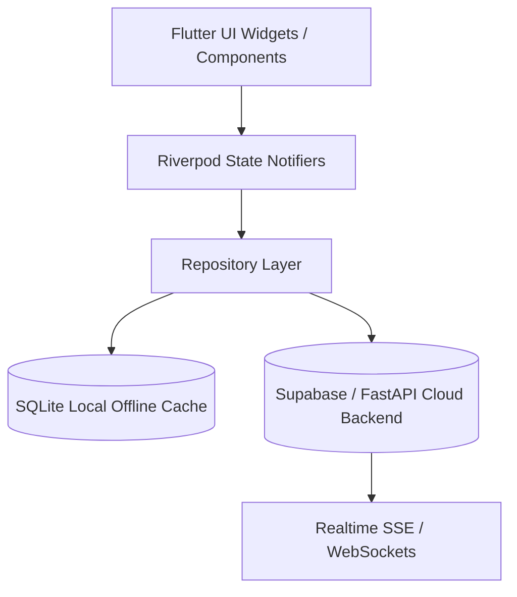

# Truthprenuer Client Application Architecture (`USERS/DOCUMENTATION/CLIENT_ARCHITECTURE.md`)

## 1. Architectural Overview
The Truthprenuer user application is built on Flutter 3.x, targeting multi-platform deployment (Web, Android, iOS, Desktop) with 100% code sharing across domain logic, repositories, and state management.

## 2. Layer Boundaries
- **Presentation (`USERS/COMPONENTS/`, `lib/views/`):** Stateless widgets, responsive adaptive shells, Cupertino/Material adaptivity.
- **State Management (`lib/application/`):** Riverpod notifiers, unidirectional data flow, immutable state.
- **Domain (`USERS/SHARED/`, `lib/domain/`, `lib/models/`):** Pure Dart entities, validation rules, consensus data models.
- **Data & Infrastructure (`lib/infrastructure/`, `lib/repositories/`):** Supabase client, offline sync queue, SQLite cache.
